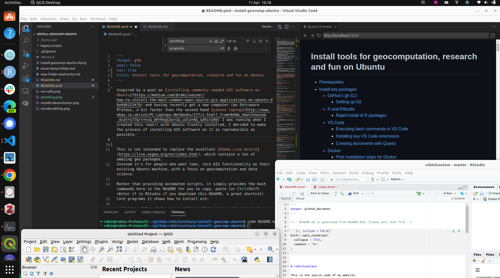
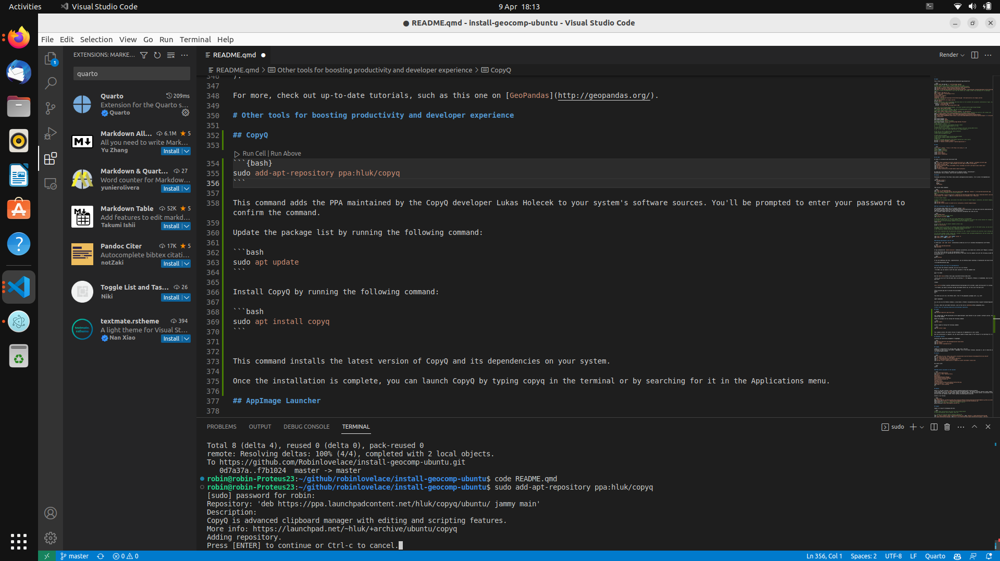
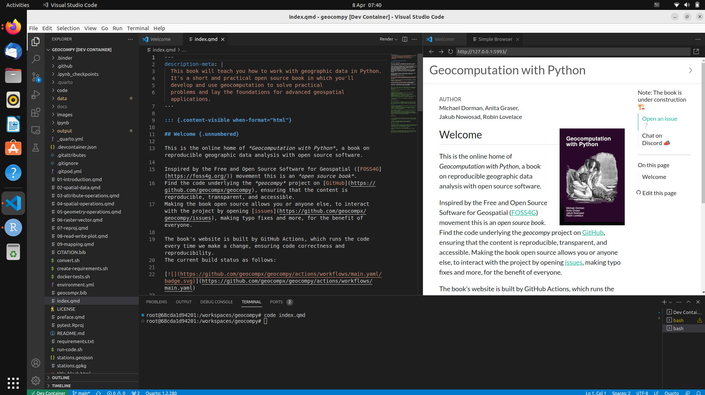
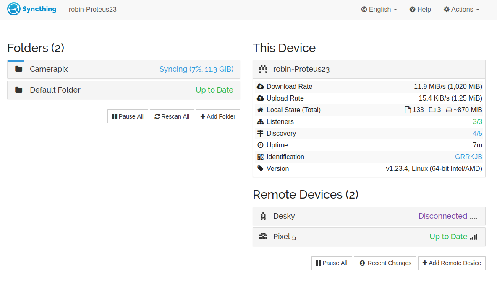

Inspired by a post on [installing commonly needed GIS software on Ubuntu](https://medium.com/@ramiroaznar/how-to-install-the-most-common-open-source-gis-applications-on-ubuntu-dbe9d612347b) and having recently got a new computer (an Entroware Proteus, a bit faster than the second hand [Lenovo laptop](http://www.ebay.co.uk/sch/PC-Laptops-Netbooks/177/i.html?_from=R40&_nkw=lenovo&_dcat=177&rt=nc&_mPrRngCbx=1&_udlo=0&_udhi=200) I was running when I created this repo!) with Ubuntu freshly installed, I decided to make the process of installing GIS software on it as reproducible as possible.
After installing this software your computer may look a bit like this:



Clutter for demo purposes!

This is not intended to replace the excellent [OSGeo Live distro](https://live.osgeo.org/en/index.html), which contains a ton of amazing geo packages.
Instead it's for people who want lean, core GIS functionality on their existing Ubuntu machine, with a focus on geocomputation and data science.

Rather than providing automated scripts, it simply provides the bash commands here in the README for you to copy, paste (or Ctrl+Shift+Enter if in RStudio if you download this README, a great shortcut)
Core programs it shows how to install are:

- GitHub's CLI tool for command-line collaboration and code sharing
- **R** with access to pre-compiled packages, a powerhouse for statistical computing
- R packages for working with spatial data
- **RStudio**, a space-aged editor for **R**
- VS Code with extensions for R, Python, C/C++, Rust, Docker, and more
- Docker, which gives ultimate power and flexibility to install and run software
- **QGIS**, probably the most popular GUI-driven GIS in the world
- Recent versions of **GDAL** and **GEOS** C/C++ libraries
- Python packages for Geographic Data Science 
- Rust, an upcoming systems language with impressive geo libs
- **Kitty**, a fast, GPU-accelerated terminal emulator that works great with Zellij

All this can be a pain to install manually.
The commands below are designed to make your life easier. 
Any comments/suggestions: welcome

## Prerequisites

- A working installation of Ubuntu 26.04, 'Resolute Raccoon' on a computer you have access to

## System Stability and Performance

If you are running memory-intensive applications (like modern browsers with many tabs, VS Code, and RStudio simultaneously), you may encounter "Out of Memory" (OOM) crashes. 
This is especially common if your swap space is small. 
You can increase your swap file to 16GB with the following commands:

```{bash}
# Check current swap
swapon --show
# Increase swap to 16GB
sudo swapoff /swap.img
sudo rm /swap.img
sudo fallocate -l 16G /swap.img
sudo chmod 600 /swap.img
sudo mkswap /swap.img
sudo swapon /swap.img
# Verify
free -h
```

# Install key packages

Fire up a terminal, e.g. with `Ctl-Alt-T` after booting Ubuntu, then enter the following.
(You can also run this from inside an editor):

```{bash}
ls
```

```{r}
ls()
```

## GitHub's gh CLI

GitHub has developed a command line interface (CLI) tool for enabling fast and intuitive interaction with the world's premier code hosting platform.
It's a good place to start because it's small, self-contained, and can be used to clone code repos like this one.
Install it with the following cryptic commands from the project's [GitHub page](https://github.com/cli/cli/blob/trunk/docs/install_linux.md):

```{bash}
type -p curl >/dev/null || (sudo apt update && sudo apt install curl -y)
curl -fsSL https://cli.github.com/packages/githubcli-archive-keyring.gpg | sudo dd of=/usr/share/keyrings/githubcli-archive-keyring.gpg \
&& sudo chmod go+r /usr/share/keyrings/githubcli-archive-keyring.gpg \
&& echo "deb [arch=$(dpkg --print-architecture) signed-by=/usr/share/keyrings/githubcli-archive-keyring.gpg] https://cli.github.com/packages stable main" | sudo tee /etc/apt/sources.list.d/github-cli.list > /dev/null \
&& sudo apt update \
&& sudo apt install gh -y
```

Test to see if it works as follows:

```{sh}
# Log-in to GitHub from the command line
gh auth login
gh repo clone Robinlovelace/install-geocomp-ubuntu
cd install-geocomp-ubuntu 
less README.md
```

You may also want to update your Git version, which is installed by default on Ubuntu:

```{bash}
sudo add-apt-repository ppa:git-core/ppa
sudo apt update
sudo apt install git
```

Previously I was on Git 2.40.0, now I'm on 2.53.0:

```{bash}
#| eval: true
git --version
```

### Setting up Git

Setup git with the following commands

```{bash}
git config --global user.email "test@test.org.uk"
git config --global user.name "trachelium"
# Set the default branch to main:
git config --global init.defaultBranch main
```

### dra

```{bash}
gh release download -R devmatteini/dra -p "*amd64.deb" -O /tmp/dra.deb --clobber
sudo apt install -y /tmp/dra.deb && rm /tmp/dra.deb
```

That allows you to download assets with commands such as:

```bash
# Automatically select and download an asset based on your operating system and architecture
# you can use -a or --automatic
dra download -a devmatteini/dra-tests
```

## R and RStudio

I have become a huge fan of VS Code and installing it plus some amazing extensions is covered in the next section.
VS Code is increasingly good with decent support for visualisations and, as the screenshot below shows, even now marks-up markdown outputs from Quarto documents.
However, if you want to do standard data science things and create reproducible documents, R+RStudio is hard to beat, especially if you're just starting out with data science.
Install them with the following commands:

These instructions are from https://github.com/eddelbuettel/r2u (which now supports Ubuntu 26.04 `resolute` and installs **R 4.5.3** along with `bspm` so `install.packages()` installs pre-compiled Ubuntu `.deb` binaries automatically):

```sh
curl -fsSL https://raw.githubusercontent.com/eddelbuettel/r2u/master/inst/scripts/add_cranapt_resolute.sh | sudo bash
```

Alternatively, to install R (**4.5.2**) from the standard Ubuntu repositories without `r2u`:

```sh
sudo apt update -qq && sudo apt install --yes --no-install-recommends r-base-core r-base-dev
```

### Rapid install of R packages

A difference between R packages on Windows and Ubuntu is that by default Windows always installs binary versions of packages, meaning no compilation time.
To speed-up installation of R packages you can add an Ubuntu repo that will allow you to install pre-compiled packages from the system command line.
Although there are projects like [r2u](https://github.com/eddelbuettel/r2u) that give you binary packages with `install.packages()` I prefer the control of using the system command line for binaries and the R console for installing packages that want to be compiled, to avoid issues like this: https://github.com/rocker-org/rocker-versioned2/issues/631

#### Posit Package Manager (RSPM)

For fast pre-compiled R package installation from within R on Ubuntu 26.04 (`resolute`), you can also use Posit Package Manager:

```{r}
# Set RSPM as the default repository for Ubuntu 26.04 (resolute)
options(repos = c(CRAN = "https://packagemanager.posit.co/cran/__linux__/resolute/latest"))
```

To make this permanent, add it to your `~/.Rprofile`:

```{bash}
echo 'options(repos = c(CRAN = "https://packagemanager.posit.co/cran/__linux__/resolute/latest"))' >> ~/.Rprofile
```

Get a load of great R packages with the following commands:

```{bash}
# System deps (only needed if compiling spatial/graphics packages from source without r2u)
sudo apt install -y libgdal-dev libproj-dev libgeos-dev libudunits2-dev libnode-dev libcairo2-dev libnetcdf-dev \
  libglu1-mesa-dev freeglut3-dev mesa-common-dev libharfbuzz-dev libfribidi-dev \
  libmagick++-dev libjq-dev libprotobuf-dev protobuf-compiler libsodium-dev imagemagick libgit2-dev

# Install core R spatial stack (uses r2u or RSPM resolute binaries)
Rscript -e 'install.packages(c("sf", "terra", "lwgeom", "mapview", "mapdeck", "shinyjs", "tmap", "mapedit", "languageserver"))'
```

RStudio Desktop (the GUI IDE, not the browser-based Server):

```{bash}
# Check for latest version at https://posit.co/download/rstudio-desktop/
RSTUDIO_VER="2026.10.1-239"
wget https://download1.rstudio.org/electron/jammy/amd64/rstudio-${RSTUDIO_VER}-amd64.deb -O /tmp/rstudio.deb
sudo apt install -y /tmp/rstudio.deb && rm /tmp/rstudio.deb
```

After installing RStudio you can open it by pressing the 'Windows button' and they typing RStudio.
You should also be able to open it with the following command in the terminal:

```{bash}
rstudio
```

After opening RStudio you can open the folder containing these instructions, or any folder, with the following command typed into the R console.

```{r, eval=FALSE}
rstudioapi::openProject("~/Download/install-geocomp-ubuntu/")
```

Also in RStudio you can commit and push changes to this or any repo as follows, starting by opening a terminal by clicking on the Terminal button or by typing the shortcut: `Alt+Shift+M`.
You can also execute lines of code from the source editor in RStudio in the terminal by typing `Ctrl+Alt+Enter`, which will send the current line of code to the terminal.

```{bash}
git status
git commit -am 'Update instructions with info on using RStudio'
```

## Python for Geocomputation

Python is a versatile language with a rich ecosystem for geographic data science. While `apt` provides some packages, using a modern environment manager like `pixi` or `uv` (installed in the [Modern Data Stack](#modern-data-stack) section) is recommended for reproducibility and avoids Ubuntu 26.04 PEP 668 (`externally-managed-environment`) errors.

To quickly install core geographic packages in a new project with `pixi`:

```bash
pixi init my-geo-project && cd my-geo-project
pixi add geopandas rasterio shapely folium matplotlib
```

Alternatively, using [`uv`](https://docs.astral.sh/uv/):

```{bash}
uv init my-geo-project && cd my-geo-project
uv add geopandas rasterio shapely folium matplotlib
```

## VS Code

VS Code is a versatile and future-proof IDE.
At the time of writing the latest stable release was **v1.145.2** (November 2026).

```{bash}
wget -qO- https://packages.microsoft.com/keys/microsoft.asc | gpg --dearmor | sudo tee /etc/apt/keyrings/microsoft.gpg > /dev/null
echo "deb [arch=$(dpkg --print-architecture) signed-by=/etc/apt/keyrings/microsoft.gpg] https://packages.microsoft.com/repos/vscode stable main" | sudo tee /etc/apt/sources.list.d/vscode.list > /dev/null
sudo apt update && sudo apt install -y code
# Core extensions for data science and development:
code --install-extension ms-python.python
code --install-extension ms-vscode-remote.remote-containers
code --install-extension ritwickdey.LiveServer
code --install-extension github.copilot
```

### Positron: a VS Code-compatible IDE

Positron is an IDE for data science from Posit. Get the latest release for your system from https://github.com/posit-dev/positron/

```{bash}
# Automatically find and download latest release (e.g. 2026.11.0-308):
gh release download -R posit-dev/positron -p "Positron-*-x64.deb" -p "Positron-*.deb" -O /tmp/positron.deb --clobber
sudo apt install -y /tmp/positron.deb && rm /tmp/positron.deb
```

### Executing bash commands in VS Code

A great feature of VS Code is that you can execute bash commands in the integrated terminal.
Open the integrated terminal by typing the shortcut: `Ctrl+J`.
Open a new terminal in VS code by typing the shortcut: `Ctrl+backtick`(`).

Executing code is made even easier by the Quarto extension for VS Code, which can be installed as follows from bash:

```{bash}
code --install-extension quarto.quarto
```

After that extension has been installed you should be able to execute code in the integrated terminal by typing `Ctrl+Enter` in the source editor, as shown in the following screenshot:



### Installing key VS Code extensions

```{bash}
code --install-extension reditorsupport.r
```

### Creating documents with Quarto

Install the Quarto command line tool (or via `pixi global install quarto`):

```{bash}
# Check for latest version at https://github.com/quarto-dev/quarto-cli/releases
QUARTO_VER="1.11.9"
wget https://github.com/quarto-dev/quarto-cli/releases/download/v${QUARTO_VER}/quarto-${QUARTO_VER}-linux-amd64.deb -O /tmp/quarto.deb
sudo apt install -y /tmp/quarto.deb && rm /tmp/quarto.deb
```

Install the Quarto R package:

```{bash}
Rscript -e "remotes::install_github('quarto-dev/quarto-r')"
```

VS Code has a nice feature that enables you to develop inside a 'devcontainer'.
Devcontainers rely on Docker, which can be installed as follows:

### LaTeX

```{bash}
# make sure perl is properly installed (e.g., apt install -y perl)
perl -mFile::Find /dev/null
# then install TinyTeX
wget -qO- "https://yihui.org/tinytex/install-bin-unix.sh" | sh
```

### Pandoc

Pandoc is required for building R Markdown vignettes and Quarto documents.
While Quarto bundles its own pandoc, the standalone version is needed for
R package development (e.g., `R CMD build`, `devtools::check()`).
Install the latest release (**3.13**) from GitHub:

```{bash}
PANDOC_VER=$(curl -s https://api.github.com/repos/jgm/pandoc/releases/latest | grep -oP '"tag_name": "\K[^"]+')
curl -fLo /tmp/pandoc.deb https://github.com/jgm/pandoc/releases/download/${PANDOC_VER}/pandoc-${PANDOC_VER}-1-amd64.deb
sudo apt install -y /tmp/pandoc.deb && rm /tmp/pandoc.deb
```

## Docker

Docker is a system platform that allows you to run applications in isolated environments called containers.
Containers are similar to virtual machines, but they are more lightweight and efficient.

### Installation

Install Docker Engine (**v29.9.3**) from the official Ubuntu 26.04 (`resolute`) APT repository:

```{bash}
sudo apt-get update && sudo apt-get install -y ca-certificates curl
sudo install -m 0755 -d /etc/apt/keyrings
sudo curl -fsSL https://download.docker.com/linux/ubuntu/gpg -o /etc/apt/keyrings/docker.asc
sudo chmod a+r /etc/apt/keyrings/docker.asc

sudo tee /etc/apt/sources.list.d/docker.sources <<EOF
Types: deb
URIs: https://download.docker.com/linux/ubuntu
Suites: $(. /etc/os-release && echo "${UBUNTU_CODENAME:-$VERSION_CODENAME}")
Components: stable
Architectures: $(dpkg --print-architecture)
Signed-By: /etc/apt/keyrings/docker.asc
EOF

sudo apt-get update
sudo apt-get install -y docker-ce docker-ce-cli containerd.io docker-buildx-plugin docker-compose-plugin
```

### Post installation steps for Docker

The following steps enable you to run docker without `sudo`.

```{bash}
sudo groupadd -f docker
sudo usermod -aG docker $USER
# Grant immediate access in current sessions without logging out (usermod persists after re-login):
sudo setfacl -m "user:$USER:rw" /var/run/docker.sock
```

Verify that you can run docker commands without `sudo`:

```{bash}
docker run hello-world
```

If you encounter permission issues with the `~/.docker` directory, fix them as follows:

```{bash}
sudo chown "$USER":"$USER" /home/"$USER"/.docker -R
sudo chmod g+rwx "$HOME/.docker" -R
```

### Running devcontainer with VS code

To check your `code` and `docker` installations worked you can try to reproduce Geocomputation with Python:

```{bash}
gh repo clone geocompx/geocompy
code geocompy
```

If you installed the `remote-containers` extension successfully, you should see a button with "Reopen in Container" in the bottom right of VS Code.

Click that button and you'll see the devcontainer launch.
If it works, you can try reproducing the entirety of the book from the command line with the following inside VS Code (you can launch the terminal by pressing Ctrl+J`):

```{bash}
quarto preview
```

If you see something like this, congratulations, you can develop almost anything in reproducible and easy-to-use devcontainers!



### Running a docker container

The following launches a docker container with JupyterLab:

```{bash}
docker run -it --rm \
  -p 8888:8888 \
  -u root \
  -v "${PWD}/jupyterlab-jovyan":/home/jovyan \
  -e NB_UID=$(id -u) \
  -e NB_GID=$(id -g) \
  -e CHOWN_HOME=yes \
  -e CHOWN_HOME_OPTS='-R' \
  glcr.b-data.ch/jupyterlab/r/geospatial
```

## QGIS

Ubuntu 26.04 ships **QGIS 3.40.15** (along with **GDAL 3.12.2** and **GEOS 3.14.1**) directly in `universe`:

```{bash}
sudo apt update && sudo apt install -y qgis qgis-plugin-grass python3-qgis
```

To install the latest upstream Long Term Release (**QGIS 3.44.15 LTR**, or use `https://qgis.org/ubuntu` for **QGIS 4.2.3**) from the official QGIS `resolute` repository:

```{bash}
sudo mkdir -m755 -p /etc/apt/keyrings
sudo wget -O /etc/apt/keyrings/qgis-archive-keyring.gpg https://download.qgis.org/downloads/qgis-archive-keyring.gpg
sudo tee /etc/apt/sources.list.d/qgis.sources <<EOF
Types: deb deb-src
URIs: https://qgis.org/ubuntu-ltr
Suites: $(lsb_release -cs)
Architectures: $(dpkg --print-architecture)
Components: main
Signed-By: /etc/apt/keyrings/qgis-archive-keyring.gpg
EOF
sudo apt update && sudo apt install -y qgis qgis-plugin-grass python3-qgis saga
Rscript -e "install.packages('qgisprocess')"
```

## Rust

```{bash}
curl --proto '=https' --tlsv1.2 -sSf https://sh.rustup.rs | sh
# Make Rust available:
source "$HOME/.cargo/env"
# Try installing a crate:
cargo install geo
cargo install geozero
cargo install zonebuilder
```

# Getting started with tools for geocomputation

Once you have the software installed, you can run it as follows:

- For QGIS, you can launch it with the usual launcher or from the command line

```
qgis # run QGIS
```

See the [QGIS manual](https://docs.qgis.org/latest/en/docs/index.html)

- For R, you can run R from the bash shell by entering `R`. For beginners, RStudio is recommended, which can be opened from the Ubuntu Dash launcher or from bash with:

```
rstudio
```

# Other tools for boosting productivity and developer experience

## Rust command-line utilities

These are some fast and versatile command-line utilities that provide an alternitive to standard Unix tools. On Ubuntu 26.04, all of the core tools below are available directly via `apt` (`ripgrep 15.1`, `fd-find 10.3`, `sd 1.0`, `eza 0.23`, `bat 0.25`, `du-dust 1.2`).

### ripgrep

ripgrep is a line-oriented search tool that recursively searches your current directory for a regex pattern. It is similar to other popular search tools like The Silver Searcher, ack, and grep.

```{bash}
sudo apt install -y ripgrep
rg --help
```

### fd

fd is a simple, fast and user-friendly alternative to find.

```{bash}
sudo apt install -y fd-find
fdfind --help
```

### sd

[sd](https://github.com/chmln/sd) is a find & replace CLI (command-line interface) tool that allows you to perform simple find & replace operations on files.

```{bash}
sudo apt install -y sd
sd --help
```

### eza

[eza](https://github.com/eza-community/eza) is a modern replacement for ls (the successor to the now-deprecated exa). It supports colors, file icons, git integration, and more.

```{bash}
sudo apt install -y eza
eza .
```

### bat

[bat](https://github.com/sharkdp/bat) is a cat(1) clone with syntax highlighting and Git integration.

```{bash}
sudo apt install -y bat
# Note: On Ubuntu, the binary is named 'batcat'. You might want to alias it:
# alias bat='batcat'
```

### dust

dust is a more intuitive version of du in rust. It provides a better way to navigate through your system and view disk usage.

```{bash}
sudo apt install -y du-dust
dust --help
```

### ripgrep_all

ripgrep_all is a tool that combines the power of ripgrep for all file formats.

```{bash}
sudo apt install build-essential pandoc poppler-utils ffmpeg ripgrep cargo
cargo install --locked ripgrep_all
```

## Modern Data Stack

These tools are essential for high-performance data engineering and geocomputation in 2026.

### DuckDB

[DuckDB](https://duckdb.org/) (**v2.0.0**) is an in-process SQL OLAP database management system. It's incredibly fast for spatial data analysis when used with the [spatial extension](https://duckdb.org/docs/extensions/spatial).

```{bash}
curl -fsSL https://install.duckdb.org | sh
```

### Pixi and uv

[Pixi](https://pixi.sh/) (**v0.84.1**) and [uv](https://docs.astral.sh/uv/) (**0.13.7**) are fast, Rust-powered package and environment managers for the Conda and Python ecosystems.

```{bash}
curl -fsSL https://pixi.sh/install.sh | bash
curl -LsSf https://astral.sh/uv/install.sh | sh
```

## btop

[btop](https://github.com/aristocratos/btop) is a modern, beautiful system resource monitor that replaces `htop`. It shows CPU, memory, disk, and network usage with eye-catching visuals and a clean TUI.

Remove legacy `htop` first:

```{bash}
sudo apt remove htop -y
```

Install btop:

```{bash}
sudo apt install btop -y
# Or for the latest version (v1.4.8) directly from GitHub:
# wget https://github.com/aristocratos/btop/releases/download/v1.4.8/btop-x86_64-unknown-linux-musl.tar.gz -O /tmp/btop.tar.gz
```

Launch with `btop`. Arrow keys to navigate, `q` to quit.

## CopyQ

[CopyQ](https://github.com/hluk/CopyQ) (**v13.0**) is an advanced clipboard manager with editing and scripting features, available directly in Ubuntu 26.04:

```{bash}
sudo apt update && sudo apt install -y copyq
```

### Windows+V Shortcut

To make CopyQ feel like Windows (and many modern Linux desktops), you can bind `Windows+V` to show the clipboard history:

```{bash}
# 1. Create a custom keybinding entry for CopyQ
gsettings set org.gnome.settings-daemon.plugins.media-keys.custom-keybinding:/org/gnome/settings-daemon/plugins/media-keys/custom-keybindings/copyq/ name 'CopyQ'
gsettings set org.gnome.settings-daemon.plugins.media-keys.custom-keybinding:/org/gnome/settings-daemon/plugins/media-keys/custom-keybindings/copyq/ command 'copyq menu'
gsettings set org.gnome.settings-daemon.plugins.media-keys.custom-keybinding:/org/gnome/settings-daemon/plugins/media-keys/custom-keybindings/copyq/ binding '<Super>v'

# 2. Link the entry to the list of active custom keybindings
# Note: This appends to the existing list safely
current_bindings=$(gsettings get org.gnome.settings-daemon.plugins.media-keys custom-keybindings | sed "s/]//" | sed "s/\[//")
new_binding="'/org/gnome/settings-daemon/plugins/media-keys/custom-keybindings/copyq/'"
if [[ $current_bindings != *"$new_binding"* ]]; then
    if [[ -z $current_bindings || $current_bindings == "@as []" ]]; then
        combined="[$new_binding]"
    else
        combined="[$current_bindings, $new_binding]"
    fi
    gsettings set org.gnome.settings-daemon.plugins.media-keys custom-keybindings "$combined"
fi
```

## AppImage Launcher

[AppImageLauncher](https://github.com/TheAssassin/AppImageLauncher/) provides intuitive and time-saving management of AppImages.

Install it from the latest beta release:

```{bash}
wget https://github.com/TheAssassin/AppImageLauncher/releases/download/v3.0.0-beta-3/appimagelauncher_3.0.0-beta-2-gha287.96cb937_amd64.deb -O /tmp/appimagelauncher.deb
sudo apt install -y /tmp/appimagelauncher.deb && rm /tmp/appimagelauncher.deb
```

## Bambu Studio

[Bambu Studio](https://bambulab.com/en-eu/download/studio) is the official slicer for Bambu Lab 3D printers. It is available as an AppImage for Linux.

Download and install the latest Ubuntu AppImage (**v02.09.01.70**) from GitHub releases:

```{bash}
mkdir -p ~/Applications && cd ~/Applications
gh release download -R bambulab/BambuStudio -p "*ubu24*.AppImage" -O BambuStudio.AppImage --clobber
chmod +x BambuStudio.AppImage
./BambuStudio.AppImage
```

To find the latest release URL manually, visit the [Bambu Studio GitHub releases page](https://github.com/bambulab/BambuStudio/releases) and copy the AppImage link for your Ubuntu version.

## LogSeq

LogSeq is an application for storing notes, todo lists, and more.

### Stable Version

You can install the latest stable version using the official automated script:

```{bash}
curl -fsSL https://raw.githubusercontent.com/logseq/logseq/master/scripts/install-linux.sh | bash -s -- --user
```

### Nightly (Database Version)

The Nightly version (Database version) introduces DB graphs and real-time collaboration. Because the asset naming for nightlies differs from stable releases, the standard script does not yet support it. Instead, use the GitHub CLI (`gh`) to download the latest nightly AppImage:

```{bash}
# Download the latest nightly AppImage
gh release download nightly -R logseq/logseq -p "*linux-x86_64*.AppImage" --clobber -O ~/Downloads/Logseq-Nightly.AppImage
chmod +x ~/Downloads/Logseq-Nightly.AppImage

# Launch it (AppImage Launcher will pick it up if installed)
~/Downloads/Logseq-Nightly.AppImage
```

## Joplin

Joplin is an open source note-taking app.

```{bash}
# Install libfuse2 (required for AppImage on Ubuntu 26.04)
sudo apt install -y libfuse2t64
# Install Joplin
wget -O - https://raw.githubusercontent.com/laurent22/joplin/dev/Joplin_install_and_update.sh | bash
```

## Zotero

```{bash}
sudo apt-get install -y libdbus-glib-1-2 libgtk-3-0 libxt6 libxrender1 libx11-xcb1
wget -O /tmp/zotero.tar.bz2 'https://www.zotero.org/download/client/dl?channel=release&platform=linux-x86_64'
sudo tar -xjf /tmp/zotero.tar.bz2 -C /opt/ && sudo mv /opt/Zotero_linux-x86_64 /opt/Zotero
sudo ln -sf /opt/Zotero/zotero /usr/local/bin/zotero
/opt/Zotero/set_launcher_icon
ln -sf /opt/Zotero/zotero.desktop ~/.local/share/applications/zotero.desktop
```

Run Zotero with:

```{bash}
zotero
```

## guake

```{bash}
sudo apt install guake
```

### Guake fix for Wayland

If the `F12` key doesn't work to show Guake in a Wayland session (the default in Ubuntu 26.04), you need to set a custom global shortcut in GNOME:

1.  Open **Settings** > **Keyboard** > **View and Customize Shortcuts**.
2.  Go to **Custom Shortcuts** and click **+**.
3.  Name: `Guake Toggle`
4.  Command: `guake-toggle`
5.  Shortcut: Press `F12`.

Alternatively, try setting it from the command line:

```{bash}
gsettings set org.gnome.settings-daemon.plugins.media-keys custom-keybindings "['/org/gnome/settings-daemon/plugins/media-keys/custom-keybindings/guake/']"
gsettings set org.gnome.settings-daemon.plugins.media-keys.custom-keybinding:/org/gnome/settings-daemon/plugins/media-keys/custom-keybindings/guake/ name 'Guake Toggle'
gsettings set org.gnome.settings-daemon.plugins.media-keys.custom-keybinding:/org/gnome/settings-daemon/plugins/media-keys/custom-keybindings/guake/ command 'guake-toggle'
gsettings set org.gnome.settings-daemon.plugins.media-keys.custom-keybinding:/org/gnome/settings-daemon/plugins/media-keys/custom-keybindings/guake/ binding 'F12'
```

### Zellij

[Zellij](https://zellij.dev/) is a terminal multiplexer (like tmux) with a more user-friendly interface. It works great inside Guake.

```{bash}
# Download and install the latest binary (v0.45.1)
wget https://github.com/zellij-org/zellij/releases/download/v0.45.1/zellij-x86_64-unknown-linux-musl.tar.gz -O /tmp/zellij.tar.gz
tar -xvf /tmp/zellij.tar.gz -C /tmp
sudo mv /tmp/zellij /usr/local/bin/ && rm /tmp/zellij.tar.gz
```

**Pro Tip: Launch Zellij by default in Guake**

1. Open `guake-prefs`.
2. Under **Shell**, set the **Default interpreter** to `/usr/local/bin/zellij`.

## Disabling the Ubuntu Dock

Some people find the docking bar on the left (the Ubuntu Dock) annoying or simply prefer more screen real estate, especially when using a terminal multiplexer like Zellij or a dropdown terminal.

To permanently disable the dock:

```{bash}
gnome-extensions disable ubuntu-dock@ubuntu.com
```

To bring it back:

```{bash}
gnome-extensions enable ubuntu-dock@ubuntu.com
```

## Kitty

[Kitty](https://sw.kovidgoyal.net/kitty/) is a cross-platform, GPU-accelerated terminal emulator that is extremely customizable and feature-rich. It supports advanced terminal protocols and is great for tools like Zellij.

```{bash}
sudo apt update && sudo apt install kitty
```

**Pro Tip: Use Kitty as a Dropdown (HUD) Terminal**

On Ubuntu (GNOME), the most reliable way is using a GNOME Extension:

1. Install the **Quake-mode** extension.
2. In settings, set **Application** to `kitty` and **Shortcut** to `F12`.
3. Add `hide_window_decorations yes` to `~/.config/kitty/kitty.conf` for a clean look.

Alternatively, use the native "Quick Access" feature (Kitty 0.42+):
- Bind `F12` to the command: `kitty +kitten quick-access-terminal`

## Ghostty

[Ghostty](https://ghostty.org/) (**v1.3.0**) is a lightning-fast, GPU-accelerated terminal emulator. On Ubuntu 26.04, it is available directly in the official `universe` repository:

```{bash}
sudo apt update && sudo apt install -y ghostty
```

**Pro Tip: Launch Ghostty with a shortcut**

To open Ghostty instantly, set a custom GNOME shortcut:

1. Open **Settings** > **Keyboard** > **View and Customize Shortcuts**.
2. Go to **Custom Shortcuts** and click **+**.
3. Name: `Launch Ghostty`
4. Command: `ghostty`
5. Shortcut: Press `Ctrl+Alt+G`.

**Pro Tip: Start Ghostty fullscreen by default**

Add the following to `~/.config/ghostty/config`:

```text
fullscreen = true
```

**Pro Tip: Use Ghostty as a Guake replacement (Dropdown)**

To get a full-width dropdown at the top of your screen on Ubuntu 26.04 (Wayland):

1. Add the following to `~/.config/ghostty/config`:

```text
# Dropdown (Quick Terminal)
keybind = global:f12=toggle_quick_terminal
quick-terminal-position = top
quick-terminal-size = 100%,40%
quick-terminal-autohide = true

# Standalone Window Behavior
maximize = true
theme = Adwaita Dark
window-decoration = false

# Keep Ghostty running in background for the toggle command to work
quit-after-last-window-closed = false
```

2. Set a custom GNOME shortcut for the toggle (`F12`):
   - Command: `ghostty +toggle_quick_terminal`

3. Set a custom GNOME shortcut for a maximized standalone window (`Ctrl+Alt+G`):
   - Command: `ghostty --maximize=true`

## Deno

```{bash}
# The official install script redirects to the latest release (v2.9.8)
curl -fsSL https://deno.land/install.sh | sh
```

## Node.js and nvm

[nvm](https://github.com/nvm-sh/nvm) (Node Version Manager) is the recommended way to install Node.js. It allows you to install and switch between different versions of Node.js easily.

```{bash}
curl -o- https://raw.githubusercontent.com/nvm-sh/nvm/v0.41.0/install.sh | bash
# Remember to source your .bashrc or restart your terminal:
# source ~/.bashrc
# Then install the latest version of Node.js:
nvm install node
```

## Claude code

```{bash}
npm install -g @anthropic-ai/claude-code
```

## Hermes Desktop

One-liner to install the latest [Hermes Desktop](https://github.com/fathah/hermes-desktop) (**v0.7.7**) from GitHub releases:

```{bash}
# Install Hermes Desktop GUI
wget -q https://github.com/fathah/hermes-desktop/releases/download/v0.7.7/hermes-desktop_0.7.7_amd64.deb -O /tmp/hermes-desktop.deb && sudo apt install -y /tmp/hermes-desktop.deb && rm /tmp/hermes-desktop.deb

# Install Hermes Agent CLI
curl -fsSL https://raw.githubusercontent.com/NousResearch/hermes-agent/main/scripts/install.sh | bash
```

Launch desktop app with: `hermes-desktop`

## Signal

Signal is an app for messaging and more.

```{bash}
# NOTE: These instructions only work for 64-bit Debian-based
# Linux distributions such as Ubuntu, Mint etc.

# 1. Install our official public software signing key:
wget -O- https://updates.signal.org/desktop/apt/keys.asc | gpg --dearmor > signal-desktop-keyring.gpg
cat signal-desktop-keyring.gpg | sudo tee /usr/share/keyrings/signal-desktop-keyring.gpg > /dev/null

# 2. Add our repository to your list of repositories:
echo 'deb [arch=amd64 signed-by=/usr/share/keyrings/signal-desktop-keyring.gpg] https://updates.signal.org/desktop/apt xenial main' |\
  sudo tee /etc/apt/sources.list.d/signal.list

# 3. Update your package database and install Signal:
sudo apt update && sudo apt install signal-desktop
```

## Flameshot

Flameshot is a powerful yet simple to use screenshot software.

```{bash}
sudo apt install flameshot
```

## Firefox (Native .deb)

Ubuntu 26.04 installs Firefox as a Snap by default, which can have higher memory overhead. 
For better performance and lower RAM usage, you can switch to the native .deb version from the official Mozilla Team PPA:

```{bash}
# 1. Backup your Snap profile (just in case)
cp -r ~/snap/firefox/common/.mozilla/firefox ~/firefox_profile_backup

# 2. Add the Mozilla Team PPA
sudo add-apt-repository ppa:mozillateam/ppa

# 3. Prioritize the PPA over the Snap stub
sudo tee /etc/apt/preferences.d/mozillateamppa << 'EOF'
Package: firefox*
Pin: release o=LP-PPA-mozillateam
Pin-Priority: 1001

Package: firefox*
Pin: release o=Ubuntu
Pin-Priority: -1
EOF

# 4. Remove Snap and install native version
sudo snap remove firefox
sudo apt install -y --allow-downgrades firefox

# 5. Restore your profile
mkdir -p ~/.mozilla/firefox
cp -r ~/firefox_profile_backup/* ~/.mozilla/firefox/
```

### Troubleshooting Firefox Launch Issues

If Firefox fails to launch or shows `Sandbox: CanCreateUserNamespace() unshare(CLONE_NEWPID): EPERM` errors on Ubuntu 26.04, you may need to adjust AppArmor and sysctl settings:

```{bash}
# 1. Allow unprivileged user namespaces (required for sandboxing)
echo "kernel.apparmor_restrict_unprivileged_userns=0" | sudo tee /etc/sysctl.d/60-apparmor-namespace.conf
sudo sysctl -p /etc/sysctl.d/60-apparmor-namespace.conf

# 2. Disable the Firefox AppArmor profile (if it conflicts with the PPA version)
sudo apt install -y apparmor-utils
sudo aa-disable /etc/apparmor.d/usr.bin.firefox
```

## Chrome

```{bash}
# Add the Google Chrome repository to your system
wget -q -O - https://dl.google.com/linux/linux_signing_key.pub | gpg --dearmor | sudo tee /usr/share/keyrings/google-chrome-keyring.gpg > /dev/null
echo "deb [arch=amd64 signed-by=/usr/share/keyrings/google-chrome-keyring.gpg] http://dl.google.com/linux/chrome/deb/ stable main" | sudo tee /etc/apt/sources.list.d/google-chrome.list

# Update your package list
sudo apt update

# Install Google Chrome
sudo apt install google-chrome-stable -y
```

## Edge

Microsoft Edge is particularly useful if you use Microsoft accounts for work (e.g. Outlook, Teams, Azure) thanks to built-in SSO and enterprise sync.

```{bash}
# Add the Microsoft Edge repository to your system
wget -qO- https://packages.microsoft.com/keys/microsoft.asc | gpg --dearmor | sudo tee /usr/share/keyrings/microsoft-edge-keyring.gpg > /dev/null
echo "deb [arch=amd64 signed-by=/usr/share/keyrings/microsoft-edge-keyring.gpg] https://packages.microsoft.com/repos/edge stable main" | sudo tee /etc/apt/sources.list.d/microsoft-edge.list

# Update your package list
sudo apt update

# Install Microsoft Edge
sudo apt install microsoft-edge-stable -y
```

## Flatpak

```{bash}
sudo apt install flatpak
sudo apt install gnome-software-plugin-flatpak
flatpak remote-add --if-not-exists flathub https://flathub.org/repo/flathub.flatpakrepo
```

## KmCaster

```{bash}
# Enable repo
flatpak remote-add --if-not-exists flathub https://flathub.org/repo/flathub.flatpakrepo
# Install dependencies
flatpak-builder build-dir com.whitemagicsoftware.kmcaster.yaml --force-clean --install-deps-only --install-deps-from flathub
# Build and install
flatpak-builder build-dir com.whitemagicsoftware.kmcaster.yaml --install --user --force-clean
# Run it
flatpak run --user com.whitemagicsoftware.kmcaster
```

## Syncthing

Syncthing is a great way to synchronize laptops, phones and other devices. I use it for syncing photos onto my laptop and into family photo albums, as shown below.



To install the latest version from the official repository:

``` bash
sudo mkdir -p /etc/apt/keyrings
sudo curl -L -o /etc/apt/keyrings/syncthing-archive-keyring.gpg https://syncthing.net/release-key.gpg
echo "deb [signed-by=/etc/apt/keyrings/syncthing-archive-keyring.gpg] https://apt.syncthing.net/ syncthing stable" | sudo tee /etc/apt/sources.list.d/syncthing.list
sudo apt update
sudo apt install syncthing
```

To enable it as a service for your user:

``` bash
sudo systemctl enable syncthing@$USER.service
sudo systemctl start syncthing@$USER.service
```

## Dropbox

Dropbox is a file hosting service that offers cloud storage and file synchronization.
The official client for Linux provides a background daemon for auto-sync.

```{bash}
# Download and install the .deb package
# Check for latest version at https://linux.dropbox.com/packages/ubuntu/
DROPBOX_VER="2026.09.28"
wget "https://www.dropbox.com/download?dl=packages/ubuntu/dropbox_${DROPBOX_VER}_amd64.deb" -O /tmp/dropbox.deb
sudo apt install -y /tmp/dropbox.deb python3-gpg && rm /tmp/dropbox.deb

# Install and start the actual sync daemon (provides a link to authenticate)
dropbox start -i
```

### Authentication and Auto-sync

To link your machine, copy the URL provided by `dropbox start -i` into a browser, log in, and click "Connect". 
The daemon will then start syncing automatically to `~/Dropbox`.

To ensure Dropbox starts on boot and manage its status:

```{bash}
# Enable autostart
dropbox autostart y

# Check sync status
dropbox status
```

If you have an **API Token** and want to use Dropbox via the command line or as a mount without the official daemon, use [Rclone](#rclone) (see below).

## Rclone

`rclone` is a tool for copying and syncing files between computers. It offers several advantages over rsync, including:

1. Support for more cloud storage providers: Rclone supports a wide range of cloud storage providers, including Dropbox, Google Drive, Amazon S3, Microsoft OneDrive, Box, among others. In contrast, rsync only supports local, networked, or remote file transfer.

2. Encryption and compression: Rclone supports several encryption methods and compression algorithms to secure and reduce the size of data during transfer. Rsynd doesn't have native support for encryption and compression.

3. Synchronization: Rclone has a built-in synchronization tool that allows you to keep your files and directories in sync across different storage locations. While rsync can be used for synchronization, it requires a bit more setup and configuration.

4. Multi-threaded transfers: Rclone can upload and download files using multiple threads simultaneously, which can significantly speed up the transfer process. Rsynce is limited to single-threaded transfers.

5. Cross-platform compatibility: Rclone is a cross-platform tool that can be run on Windows, Linux, macOS, and other operating systems. Rsync, on the other hand, is primarily a Unix-based tool and may require additional setup on non-Unix systems.

Install it with:
  
```bash
sudo apt install rclone
```

## Peak

Install the screenshare-to-GIF tool Peak with the following commands on Ubuntu:

```{bash}
# Install simple screen recorder on ubuntu:
sudo apt install simplescreenrecorder
```

## Discord

Download discord from https://discord.com/download and install it with:

```{bash}
sudo apt install -y ./discord.deb
```

## Slack

```{bash}
sudo snap install slack --classic
```

## Telegram

```{bash}
sudo snap install telegram-desktop
```

## OneDrive

Ubuntu 26.04 includes `onedrive` (**v2.5.10**) in `universe` (`sudo apt install -y onedrive`), or you can install the latest build from the [OpenSUSE Build Service repository for Ubuntu 26.04](https://github.com/abraunegg/onedrive/blob/master/docs/ubuntu-package-install.md):

```{bash}
wget -qO - https://download.opensuse.org/repositories/home:/npreining:/debian-ubuntu-onedrive/xUbuntu_26.04/Release.key | gpg --dearmor | sudo tee /usr/share/keyrings/obs-onedrive.gpg > /dev/null
echo "deb [arch=$(dpkg --print-architecture) signed-by=/usr/share/keyrings/obs-onedrive.gpg] https://download.opensuse.org/repositories/home:/npreining:/debian-ubuntu-onedrive/xUbuntu_26.04/ ./" | sudo tee /etc/apt/sources.list.d/onedrive.list
sudo apt-get update && sudo apt install -y --no-install-recommends --no-install-suggests onedrive
```

## OnlyOffice

```{bash}
wget https://download.onlyoffice.com/install/desktop/editors/linux/onlyoffice-desktopeditors_amd64.deb -O /tmp/onlyoffice.deb
sudo apt install -y /tmp/onlyoffice.deb && rm /tmp/onlyoffice.deb
```

## Google Antigravity IDE

[Antigravity](https://antigravity.google) is Google's AI-powered, "agent-first" Integrated Development Environment (IDE) built for the next generation of software engineering.

### Installation for Linux

#### Debian/Ubuntu-based distributions

Install the IDE via the official Google APT repository:

```{bash}
# 1. Add the repository to sources.list.d
sudo mkdir -p /etc/apt/keyrings
curl -fsSL https://us-central1-apt.pkg.dev/doc/repo-signing-key.gpg | \
  sudo gpg --dearmor --yes -o /etc/apt/keyrings/antigravity-repo-key.gpg
echo "deb [signed-by=/etc/apt/keyrings/antigravity-repo-key.gpg] https://us-central1-apt.pkg.dev/projects/antigravity-auto-updater-dev/ antigravity-debian main" | \
  sudo tee /etc/apt/sources.list.d/antigravity.list > /dev/null

# 2. Update the package cache and install
sudo apt update
sudo apt install antigravity
```

#### RPM-based distributions (eg. Red Hat, Fedora, SUSE)

```{bash}
# 1. Add the repository to /etc/yum.repos.d
sudo tee /etc/yum.repos.d/antigravity.repo << EOL
[antigravity-rpm]
name=Antigravity RPM Repository
baseurl=https://us-central1-yum.pkg.dev/projects/antigravity-auto-updater-dev/antigravity-rpm
enabled=1
gpgcheck=0
EOL

# 2. Update the package cache and install
sudo dnf makecache
sudo dnf install antigravity
```

### Antigravity (Python Easter Egg)

For when you just need to float away from your geocomputation tasks for a moment. Inspired by [xkcd 353](https://xkcd.com/353/):

```{bash}
python3 -c "import antigravity"
```

## Reproducing the Geocomputation with R book

To reproduce the book, follow these steps:

```{bash}
gh repo clone geocompx/geocompr
cd geocompr
# Install dependencies (may require multiple runs to catch all indirect deps)
Rscript -e 'pak::pak("geocompx/geocompkg", dependencies = TRUE)'
# Render the book
Rscript -e 'bookdown::render_book("index.Rmd")'
```

### Issues encountered and fixed during reproduction

1.  **Missing Dependencies:** Several packages were missing from `geocompkg`'s dependency list. You may need to manually install: `downlit`, `rcartocolor`, `rmapshaper`, `smoothr`, `kableExtra`, `magick`, `rnaturalearth`, `ggspatial`, `sfnetworks`, `mlr3tuning`, `pROC`, `stplanr`, `z22`, `tree`, and `vegan`.
2.  **External Pointer Error (Chapter 9):** In `09-mapping.Rmd`, the `nz_elev` object's C++ pointer could become invalid across R sessions. Fixed by adding a `tryCatch` to reload the raster if needed.
3.  **Data.table Syntax Error (Chapter 12):** In `12-spatial-cv.Rmd`, standard data.frame objects were being indexed using data.table syntax. Fixed by switching to standard R indexing.
4.  **Shared Library Issue:** `igraph` may fail to load if `libxml2` versions don't match. Reinstalling `igraph` with `pak` or from RSPM binaries usually fixes this.

# Alternative projects

- [ubuntu-post-install](https://github.com/snwh/ubuntu-post-install)
- [install-tl-ubuntu](https://github.com/scottkosty/install-tl-ubuntu)
